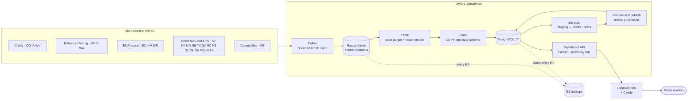

# Architecture

Official election results move from 24 state election offices to a public dashboard
in four steps: **collect** the official files, **parse** them into one contract,
**model and validate** them in PostgreSQL with dbt, then **publish** a frozen
snapshot that the dashboard reads. Everything runs on one AWS Lightsail host; backups
go to S3 and alerts to SNS.

| Page | What it shows |
| --- | --- |
| [Data collection](data-collection.md) | Source platforms, the bounded collector, archives and backoff |
| [Processing and modelling](processing-and-modelling.md) | Parse, load, dbt layers, validation and publication |
| [AWS infrastructure](aws-infrastructure.md) | Lightsail host, containers, CDN, S3, SNS, CloudWatch, IAM |
| [Operations](operations.md) | Timers, state rollout, backups and retention, monitoring |

## End to end

## Key design rules

- **Evidence first.** Every official file is archived by SHA-256 before parsing, and
  raw archives are never pruned. Any parsed output can be re-created from them.
- **One contract per state.** A `State` entry in `src/election_pipeline/states.py`
  defines races, vote methods and flags; dbt models and migrations are generated from
  it (`scripts/new_state.py`).
- **Nothing partial is public.** A release is published only after the full dbt build
  and every data test pass, and it is frozen under a `publication_id`. The dashboard
  reads only the current publication.
- **States are isolated.** Each state has its own schema, lock, pinned collector image
  and dbt tag, so one failing state does not block another.
