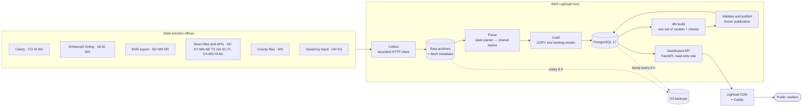

# Architecture

Official election results move from 24 state election offices to a public dashboard
in four steps: **collect** the official files, **parse** them into one shared layout,
**model and validate** them in PostgreSQL with dbt, then **publish** a frozen
snapshot that the dashboard reads. Everything runs on one AWS Lightsail host; backups
go to S3 and alerts to SNS.

| Page | What it shows |
| --- | --- |
| [Data collection](data-collection.md) | Source platforms, the bounded collector, archives and backoff |
| [Processing and modelling](processing-and-modelling.md) | Parse, load, dbt, validation and publication |
| [AWS infrastructure](aws-infrastructure.md) | Lightsail host, containers, CDN, S3, SNS, CloudWatch, IAM |
| [Operations](operations.md) | Timers, releases, backups and retention, monitoring |

## End to end

## Key design rules

- **Evidence first.** Every official file is archived by SHA-256 before parsing, and
  raw archives are never pruned. Any parsed output can be re-created from them.
- **One registry, one layout.** A `State` entry in `src/election_pipeline/states.py`
  defines a state's races, vote methods and flags. Every parser writes the layout of
  `parsers/results.py`; every state shares the same tables and dbt models, which the
  state's entry parameterizes. Adding a state needs no migration or SQL.
- **Nothing partial is public.** A release is published only after the full dbt build
  and every data test pass, and it is frozen under a `publication_id`. The dashboard
  reads only the current publication.
- **States fail independently.** Each source has its own lock, job and publication;
  one failing state does not block another. One release (image) runs them all, and a
  new release becomes current only after every enabled source validates under it.
