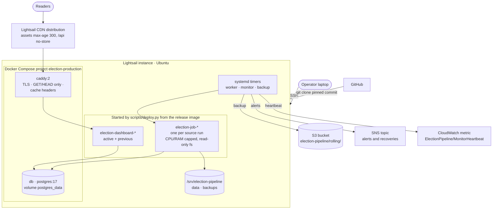
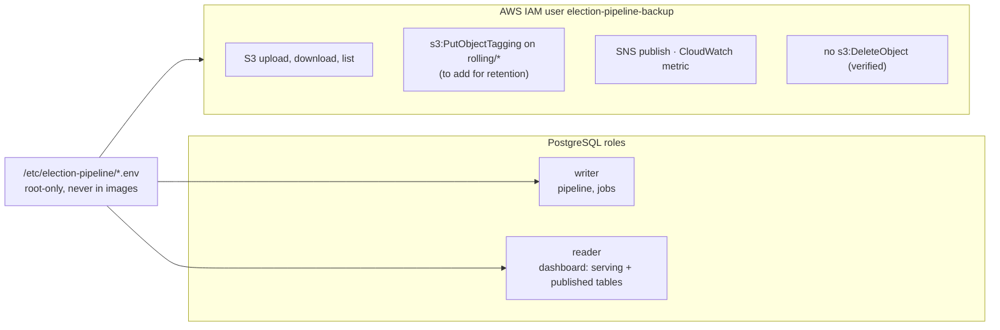
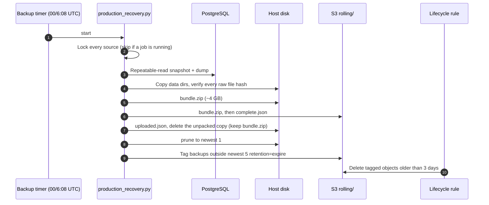

# AWS infrastructure

Production is one Lightsail instance in `us-east-2` (2 vCPU, 3.7 GiB RAM, 77 GB disk)
running Docker, PostgreSQL and systemd timers. AWS services around it handle
delivery (Lightsail CDN), backups (S3), alerts (SNS) and liveness (CloudWatch).

## Services

## Releases on the host

- `/opt/election-releases/<commit>`: an immutable checkout with its control venv; the
  image `election-pipeline:<commit>` is built from it and tested inside itself.
- `/opt/election-releases/current`: the symlink the systemd units run from.
- `/var/lib/election-pipeline-deployment/catalog.json`: the current and previous
  release, the dashboards, and each source's flags.
- Jobs run with `--read-only`, `--cap-drop ALL`, a non-root user, PID limits and the
  `JOB_CPUS` / `JOB_MEMORY` caps. Candidate dashboards start privately on
  `127.0.0.1:<port>`; `activate` switches Caddy and keeps the previous for rollback.

## Access and credentials

The backup user cannot delete. Old backups are removed by a bucket lifecycle rule
once tagged, so a compromised host cannot erase recent backups.

## Backups to S3

Details and the one-time IAM and lifecycle setup are in [../backups.md](../backups.md).
