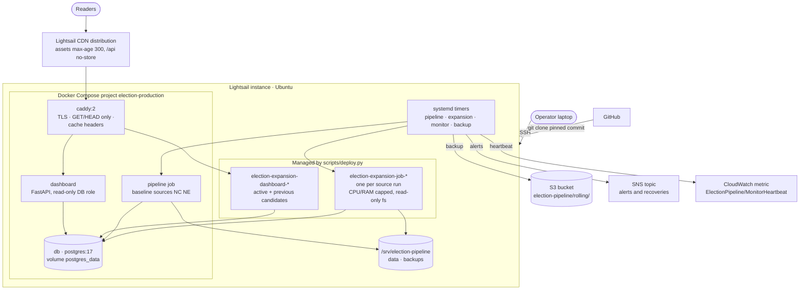
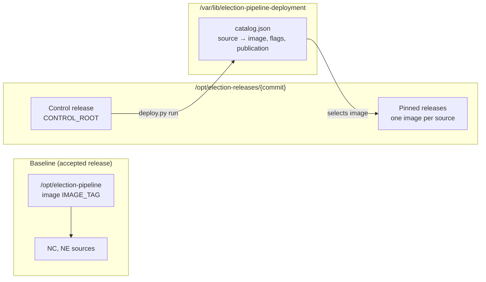
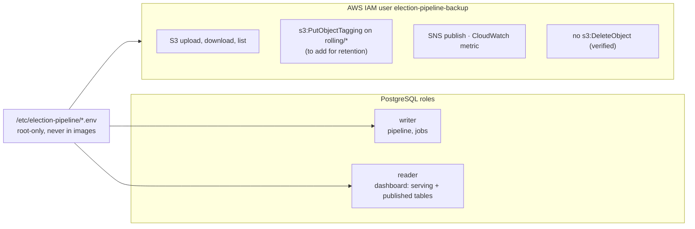

# AWS infrastructure

Production is one Lightsail instance in `us-east-2` (2 vCPU, 3.7 GiB RAM, 77 GB disk)
running Docker, PostgreSQL and systemd timers. AWS services around it handle
delivery (Lightsail CDN), backups (S3), alerts (SNS) and liveness (CloudWatch).

## Services

## Isolation on the host

- Each expansion source is pinned to one immutable image; a code fix moves it with
  `deploy.py repin` after a validated prepare-only run.
- Expansion jobs run in containers with `--read-only`, `--cap-drop ALL`, a non-root
  user, PID limits and `EXPANSION_CPUS` / `EXPANSION_MEMORY` caps.
- Candidate dashboards start privately on `127.0.0.1:<port>`; `activate` switches
  Caddy to one and keeps the previous running for rollback.

## Access and credentials

The backup user cannot delete. Old backups are removed by a bucket lifecycle rule
once tagged, so a compromised host cannot erase recent backups.

## Backups to S3

Details and the one-time IAM and lifecycle setup are in [../backups.md](../backups.md).
