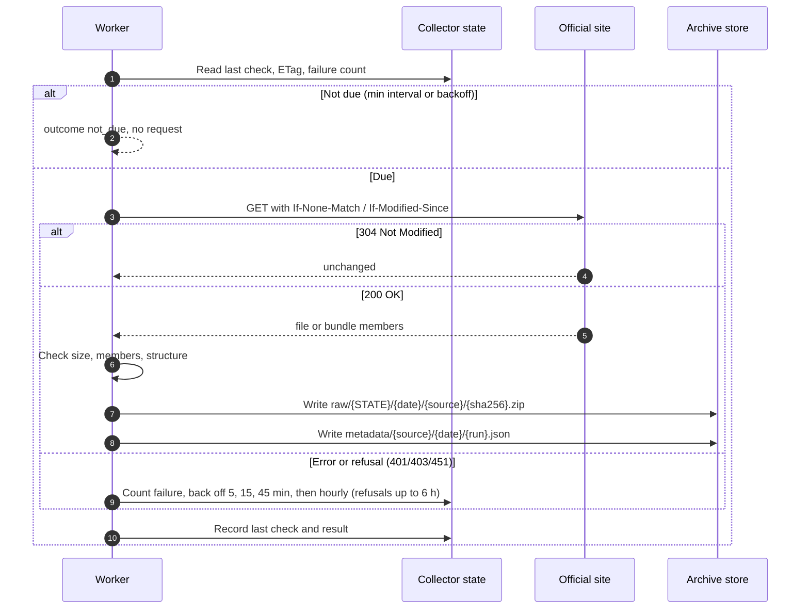
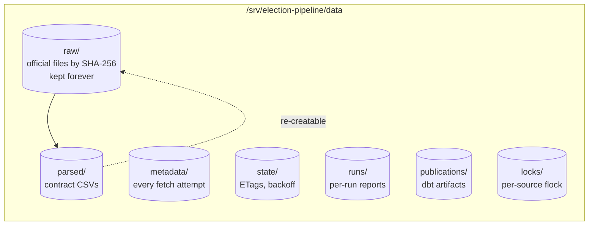

# Data collection

Each registered source in `config/sources.toml` names one official URL (or a bundle of
URLs) for one state. A collection run downloads it through one bounded client, stores
the bytes by hash, and records what happened.

## Source platforms

Most states publish through one of a few vendor platforms, so collectors are shared.
Each state appears once below, by how its results arrive (`State.collection_backend`
in `states.py`; manual imports are set in the production catalog, see
[manual results](../manual-results.md)). `tests/test_docs.py` fails when a registered
state is missing or listed twice.

```mermaid
flowchart TB
    subgraph Shared["Shared platform collectors"]
        CL["clarity.py<br/>Clarity / Scytl"]
        EV["enhanced_voting.py<br/>Enhanced Voting"]
        EN["enr_export.py<br/>ASP.NET ENR export"]
        GF["gated_files.py<br/>files gated on a primary"]
        CF["county_files.py<br/>independent county files"]
    end
    subgraph Own["A state's own collector"]
        SO["alabama.py · connecticut.py ·<br/>indiana.py · montana.py · vermont.py"]
    end
    BU["Bundle / single file<br/>(settings + common.py)"]
    MAN["Manual import<br/>operator-saved official files"]

    CO & IA & SC & WV --> CL
    GA & ID & RI & UT & VA & WA --> EV
    NM & OR & SD --> EN
    CA & MD --> GF
    MS --> CF
    AL & CT & IN & MT & VT --> SO
    AK & AR & DE & FL & HI & LA & MA & MN & NC & ND & NE & TX --> BU
    AZ & IL & KS & KY & ME & MI & MO & NH & NJ & NV & NY & OH & OK & PA & TN & WI & WY --> MAN

    CL & EV & EN & GF & CF & SO & BU --> CLIENT["Bounded HTTP client<br/>timeouts · size and row limits ·<br/>redirect checks · user agent"]
    MAN --> CHECK["Same archive and parse path<br/>reviewed receipt · freshness limit"]
```

Parsers share platform readers too: `parsers/clarity.py`, `enhanced_voting.py`,
`enr_platform.py` and `tally.py` (Arkansas and North Dakota). Illinois and New Jersey
read county Clarity sites inside their manual imports.

Some states need one-off handling: Texas reads the Civix API (`parsers/tx.py`),
Alaska pins its issuer certificates (`resources/alaska-issuers.pem`), and Florida's file
host alone also trusts one reviewed root the image lacks (`resources/florida-root.pem`).

## One collection run

## What is stored

`scripts/prune_data.py` removes re-creatable files after 7 days (old run reports,
superseded parser outputs, dbt artifacts). `raw/`, `metadata/` and `state/` are never
pruned; backups verify every snapshot's raw file against its hash.

## Safety rules

- Every source holds a collection lock and a pipeline lock, so two jobs never write the
  same source.
- A file that fails a structural check is quarantined, not parsed.
- Manual snapshots (`scripts/manual_source.py`) go through the same archive and parse
  path, with a reviewed receipt and its own freshness limit.
