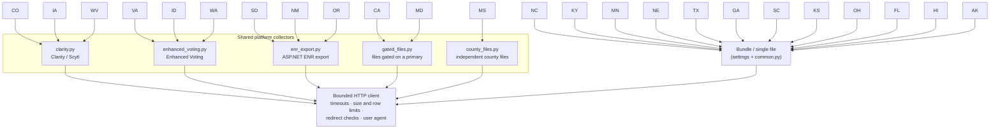
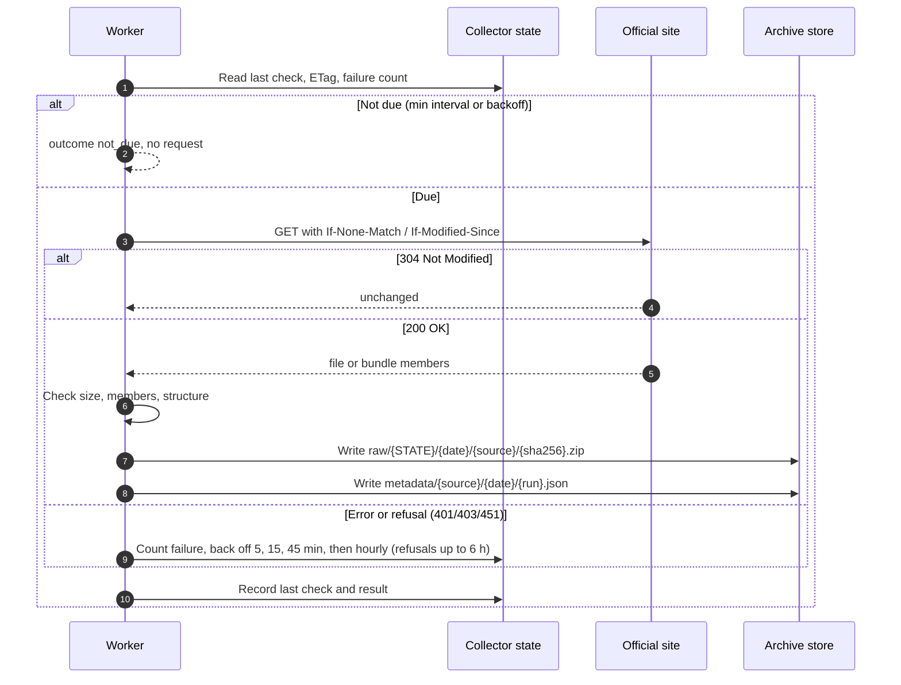
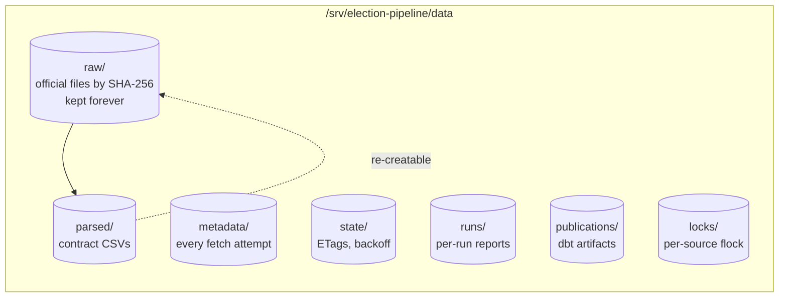

# Data collection

Each registered source in `config/sources.toml` names one official URL (or a bundle of
URLs) for one state. A collection run downloads it through one bounded client, stores
the bytes by hash, and records what happened.

## Source platforms

Most states publish through one of a few vendor platforms, so collectors are shared.

Some states need one-off handling: South Carolina resolves dated workbooks from its
fallback page (`collectors/sc.py`), Texas reads the Civix API (`parsers/tx_civix.py`),
and Alaska pins its issuer certificates (`resources/alaska-issuers.pem`).

## One collection run

## What is stored

`scripts/prune_data.py` removes re-creatable files after 7 days (old run reports,
superseded parser outputs, dbt artifacts). `raw/`, `metadata/` and `state/` are never
pruned; backups verify every snapshot's raw file against its hash.

## Safety rules

- Every source holds a collection lock and a pipeline lock, so two jobs never write the
  same source.
- A file that fails a structural check is quarantined, not parsed.
- Manual snapshots (`scripts/manual_source.py`) go through the same archive and parse
  path, with a reviewed receipt and its own freshness limit.
