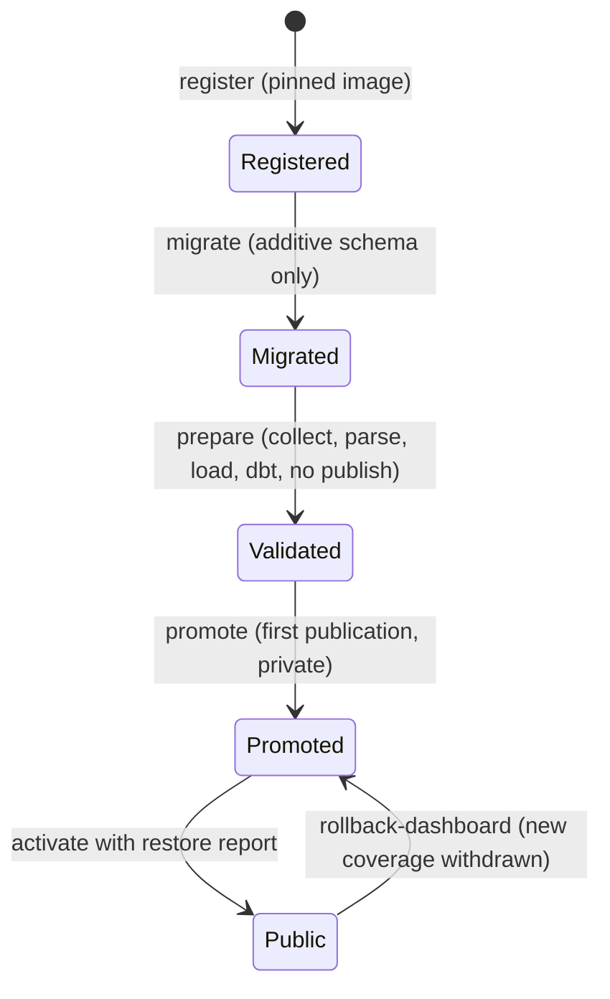
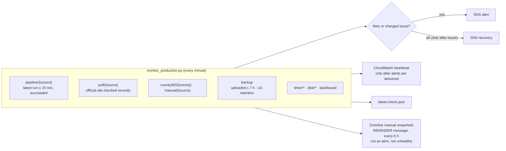
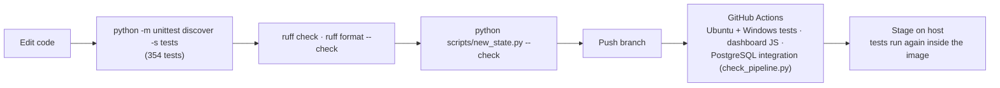

# Operations

## Schedules

```mermaid
gantt
    title One hour of scheduled work (UTC)
    dateFormat HH:mm
    axisFormat %H:%M
    section Baseline pipeline · every 5 min
    run :00:00, 1m
    run :00:05, 1m
    run :00:10, 1m
    run :00:15, 1m
    section Expansion worker · every 5 min, ≤ 270 s
    cycle :00:00, 4m
    cycle :00:05, 4m
    cycle :00:10, 4m
    section Monitor · every minute
    checks :00:00, 15m
    section Backup · four times a day
    full backup (~21 min) :00:02, 21m
```

| Timer | Runs | Does |
| --- | --- | --- |
| `election-pipeline.timer` | every 5 minutes | Baseline sources in the accepted image |
| `election-expansion.timer` | every 5 minutes, at :30 s | `deploy.py run`: each enabled expansion source, oldest first, within `CYCLE_SECONDS` (270); `EXPANSION_PARALLEL` jobs at once |
| `election-monitor.timer` | every minute | Freshness, failures, timers, backup age, disk, dashboard; SNS alerts and CloudWatch heartbeat |
| `election-backup.timer` | every 6 hours | Full backup to S3, local prune, S3 retention tags |

## Adding a state

```mermaid
flowchart LR
    subgraph dev["On the laptop"]
        A["State entry<br/>states.py"] --> B["Source contract<br/>sources.toml"]
        B --> C["Parser + roster<br/>parsers/xx.py · rosters_2026/XX.json"]
        C --> D["python scripts/new_state.py XX<br/>dbt models, tests, migration"]
        D --> E["Map + fixtures + tests<br/>fetch_boundaries.py"]
        E --> F["Push branch · CI"]
    end
    subgraph host["On the Lightsail host"]
        G["stage_coverage_release.sh<br/>build image, run tests in it"]
        H["register → migrate → prepare<br/>private, outcome validated"]
        I["promote<br/>first publication"]
        J["backup + check-restore"]
        K["start-dashboard<br/>private candidate"]
        L["activate<br/>Caddy switches"]
        G --> H --> I --> J --> K --> L
    end
    F --> G
```

## Monitoring

Overdue manual snapshots (`manual/*`, manual MS counties) are operator tasks, so they go
out as separate `REMINDER` messages and never mark the deployment unhealthy. Repeated
alerts are deduplicated with a periodic reminder; a `--dry-run` prints the
assessment without sending or saving anything.

## Development loop

