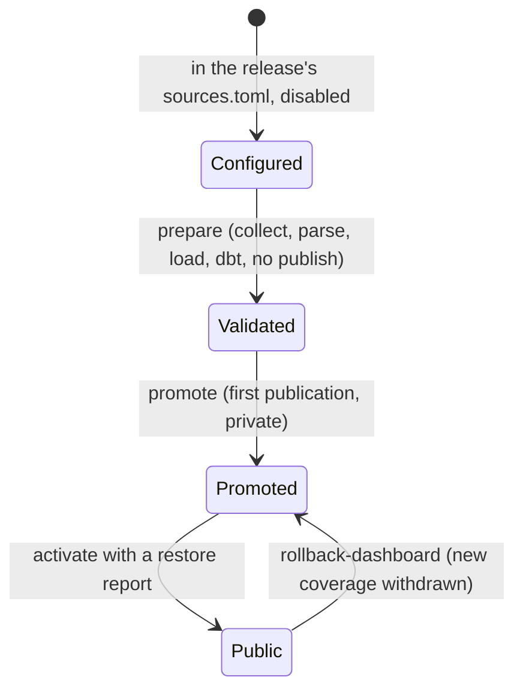
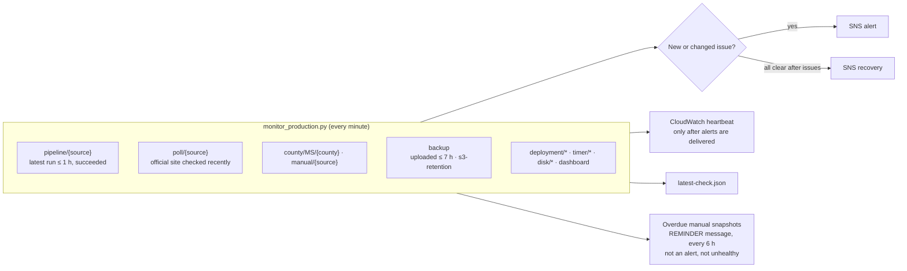
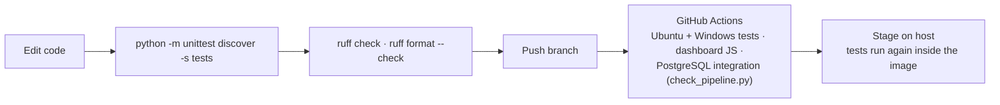

# Operations

## Schedules

```mermaid
gantt
    title One hour of scheduled work (UTC)
    dateFormat HH:mm
    axisFormat %H:%M
    section Worker · every 5 min, ≤ 270 s
    cycle :00:00, 4m
    cycle :00:05, 4m
    cycle :00:10, 4m
    section Monitor · every minute
    checks :00:00, 15m
    section Backup · four times a day
    full backup (~21 min) :00:02, 21m
```

| Timer | Runs | Does |
| --- | --- | --- |
| `election-worker.timer` | every 5 minutes, at :30 s | `deploy.py run`: every enabled HTTP source in the release image, least recently run first, within `CYCLE_SECONDS` (270); `JOB_PARALLEL` jobs at once. Each source is due every 15 minutes (`min_interval_seconds = 840`) |
| `election-monitor.timer` | every minute | Freshness, failures, release, timers, backup age, disk, dashboard; SNS alerts and CloudWatch heartbeat |
| `election-backup.timer` | every 6 hours | Full backup to S3, local prune, S3 retention tags |

All three run from `/opt/election-releases/current`, the symlink `deploy.py release`
moves; see [deployment](../deployment.md).

## Releasing and adding a state

```mermaid
flowchart LR
    subgraph dev["On the laptop"]
        A["State entry · states.py"] --> B["Source · sources.toml"]
        B --> C["Parser + roster<br/>parsers/xx.py · rosters_2026/XX.json"]
        C --> E["Map + fixtures + tests<br/>fetch_boundaries.py"]
        E --> F["Push branch · CI"]
    end
    subgraph host["On the Lightsail host"]
        G["stage_release.sh<br/>checkout, image, tests in it"]
        H["deploy.py release<br/>migrate, check every source, switch"]
        I["prepare → promote<br/>new state's first publication"]
        J["backup + check-restore"]
        K["start-dashboard --source<br/>private candidate"]
        L["activate<br/>Caddy switches"]
        G --> H --> I --> J --> K --> L
    end
    F --> G
```

## Monitoring

Overdue manual snapshots (`manual/*`, manual MS counties) are operator tasks, so they go
out as separate `REMINDER` messages and never mark the deployment unhealthy; a source
configured as final (Kansas) is never overdue. Repeated alerts are deduplicated with a
periodic reminder; a `--dry-run` prints the assessment without sending or saving.

## Development loop

