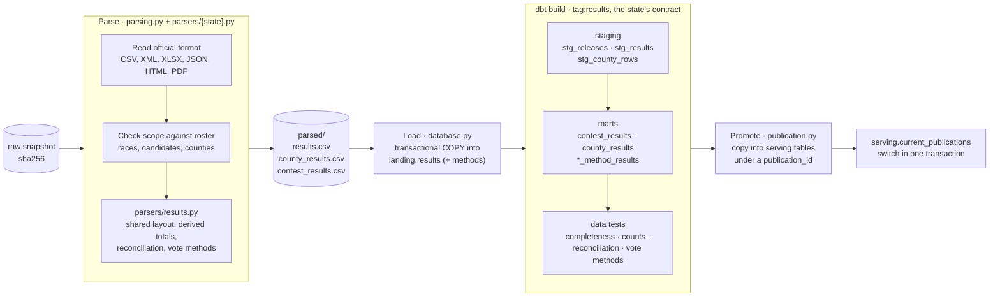
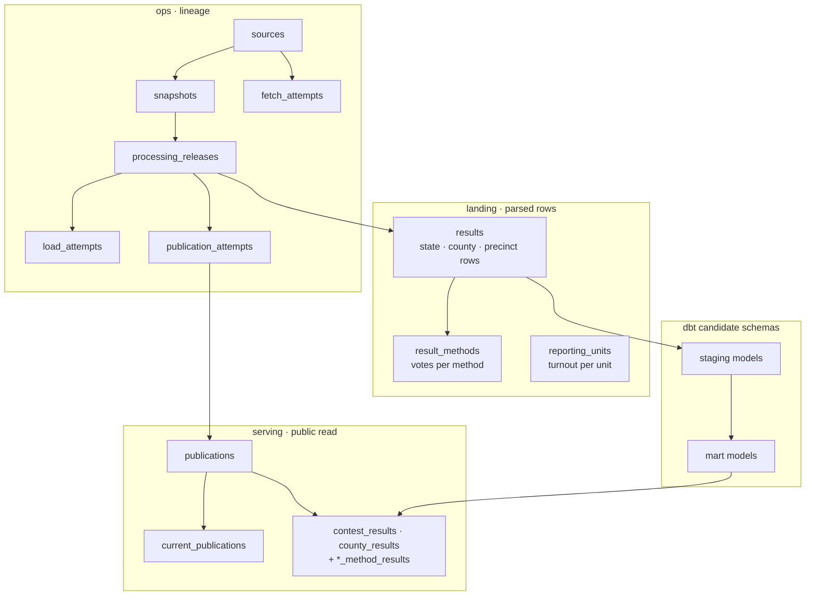
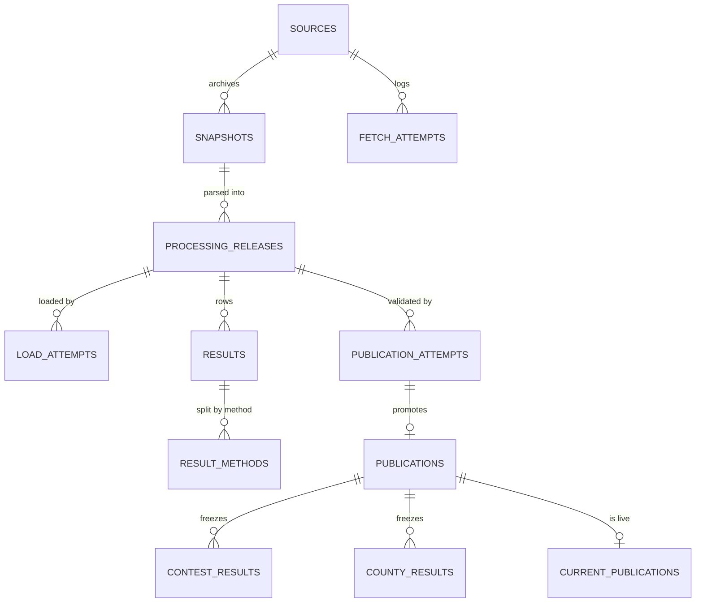
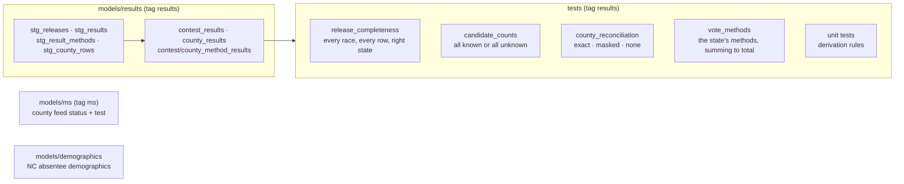
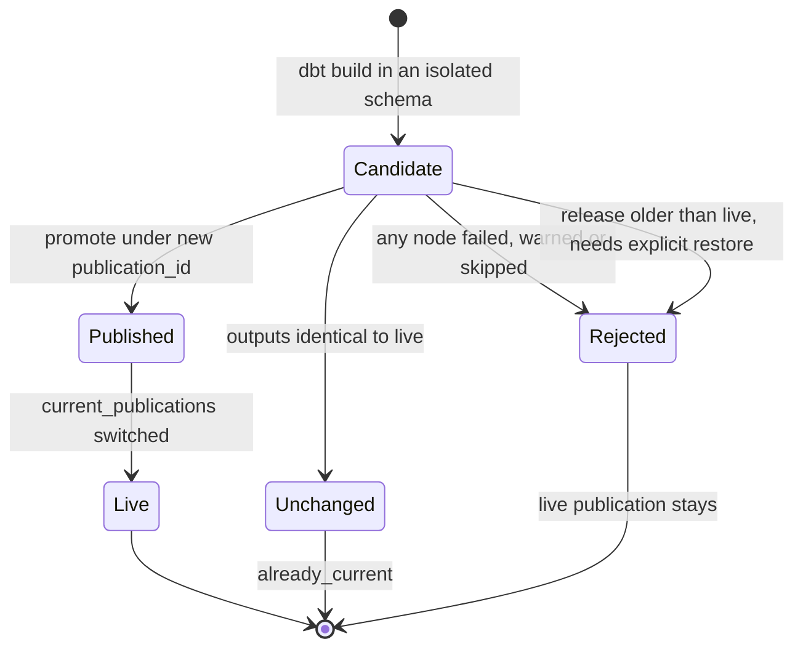

# Processing and modelling

After collection, one pipeline run per source takes a raw snapshot to a public
publication in three more stages: **parse**, **load**, then **validate and publish**.
Each stage is skipped when its input has not changed (`already_parsed`, `skipped`,
`already_current`).

## Stages of one run

A parser emits the rows its source publishes, statewide, county or precinct. The
shared `finish` derives what the source does not print: county totals from precincts
(North Carolina) and statewide totals from counties (Mississippi, Florida). A parser
that finds an unexpected race, candidate or county, a county total that does not match
the state, or vote methods that do not add up, stops the run with `validation_failed`;
nothing is loaded.

## Database layout

Every state shares one set of tables (migration `024_shared_results.sql`); each row
carries its state. Mississippi's county collection health and North Carolina's
absentee demographics keep tables of their own.

The dashboard role can read only `serving` (and Mississippi's published county
status); it cannot see `ops`, `landing` or dbt schemas. The per-state schemas of
migrations 003–023 hold the rows from before consolidation; cutover copied them into
the shared tables (`consolidate.py`), and nothing writes to them any more.

## dbt

One project serves every state. `publication.build_candidate` builds one release and
passes its state's contract from the registry: `state`, `races`, `methods` and
`county_reconciliation` (`exact`, `masked` for New Mexico's privacy-masked counties,
or `none` for states without county results).

Mississippi builds `tag:results tag:ms`; the demographics dataset builds
`tag:demographics`. Tests run with cautious indirect selection, so a test runs only
when every model it reads was built.

## Publication rules

A per-state advisory lock stops two publications for one state from overlapping;
different states publish in parallel. Florida orders releases by the official file's
own timestamps, so an older file served again by the state cannot replace newer
results; Iowa treats byte-different Clarity bundles of one results version as the
same release.
