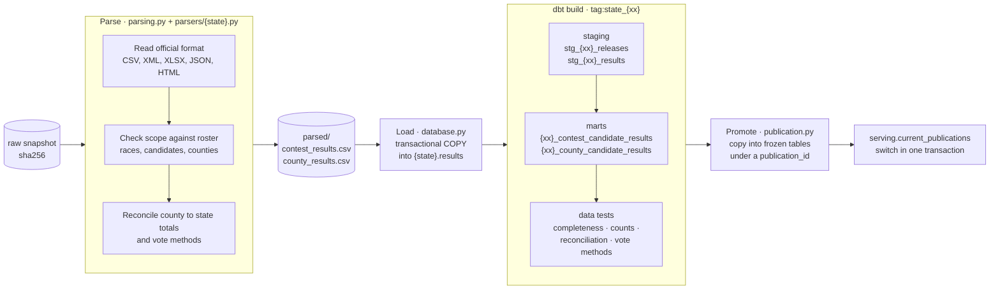
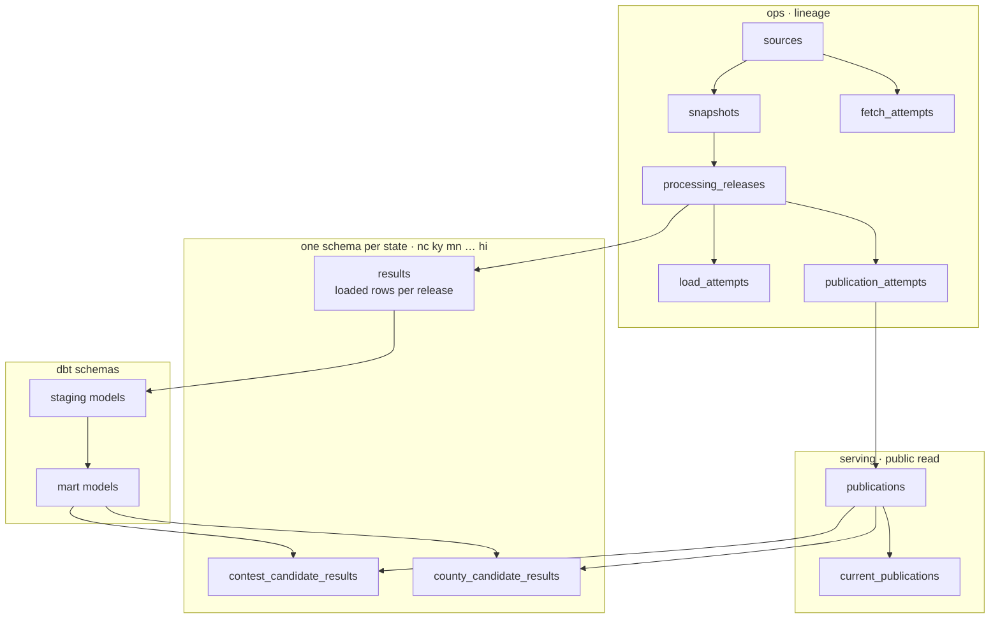
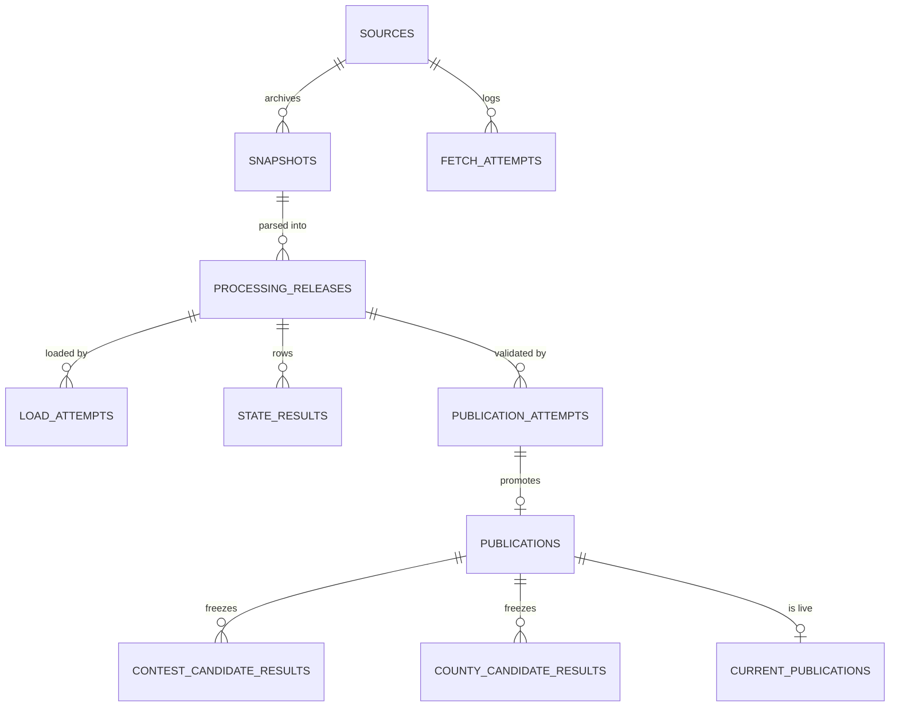
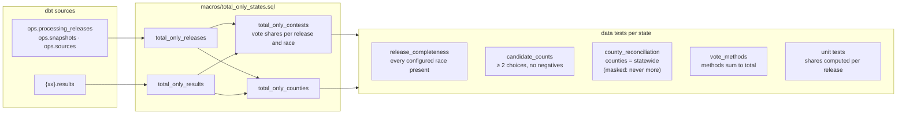
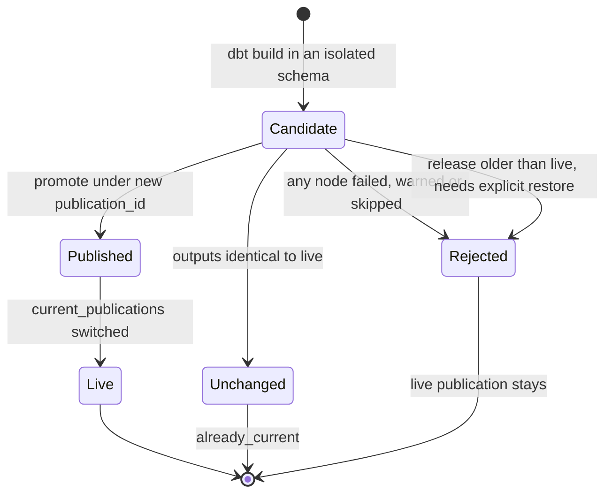

# Processing and modelling

After collection, one pipeline run per source takes a raw snapshot to a public
publication in three more stages: **parse**, **load**, then **validate and publish**.
Each stage is skipped when its input has not changed (`already_parsed`, `skipped`,
`already_current`).

## Stages of one run

A parser that finds an unexpected race, candidate or county, a county total that does
not match the state, or vote methods that do not add up, stops the run with
`validation_failed`; nothing is loaded.

## Database layout

The dashboard role can read only `serving` and each state's two published tables
(`GRANT SELECT` in each migration); it cannot see `ops`, raw rows or dbt schemas.

## dbt layers

Eighteen states use these shared macros, and their per-state SQL and YAML files are
generated from the registry by `scripts/new_state.py`. NC, KY, MN, NE, TX and MS keep
hand-written models. Each run selects only its state, `--select tag:state_<xx>`, so
states publish independently.

## Publication rules

A per-state advisory lock stops two publications for one state from overlapping;
different states publish in parallel. Florida orders releases by the official file's
own timestamps, so an older file served again by the state cannot replace newer
results.
